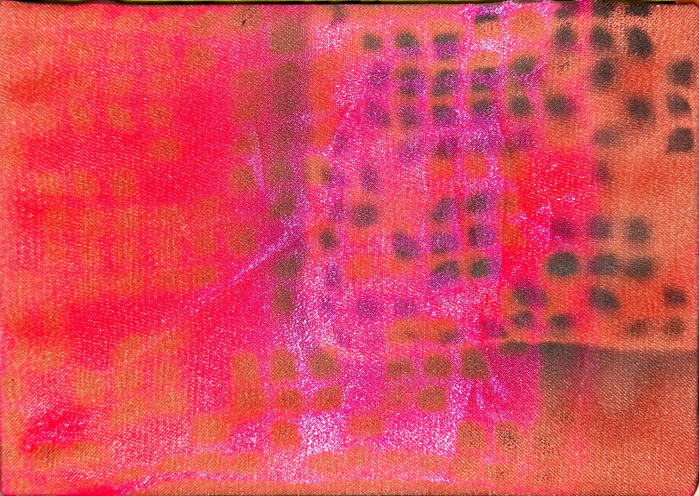
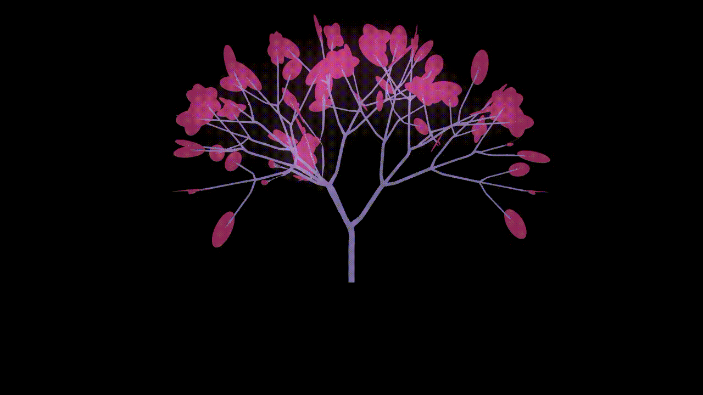
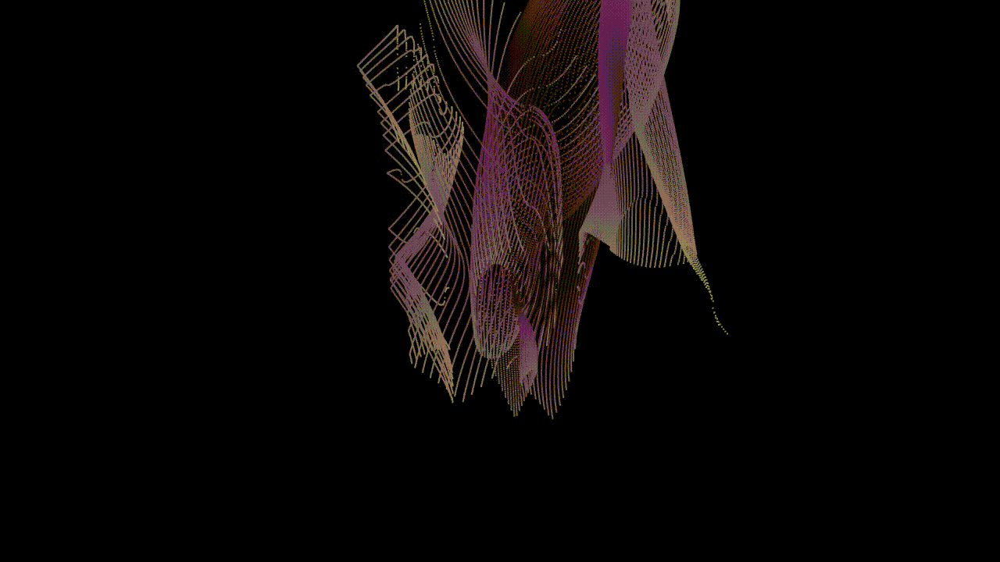
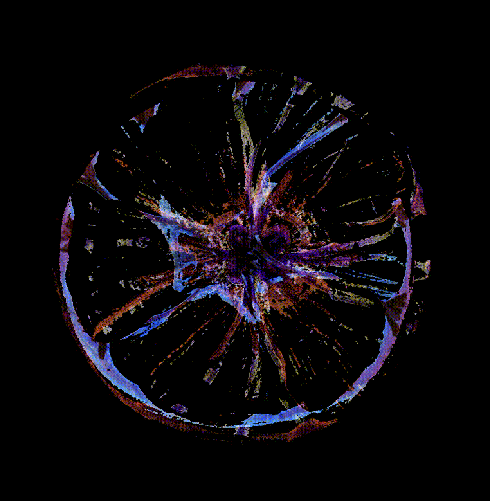

<style>

body {
    background-image: url('assets/img/reticula.gif') !important;
    background-size: cover !important;
    background-position: center !important;
    background-attachment: fixed !important;
    background-repeat: no-repeat !important;
    color: #f52063;
}

/* Fondo semitransparente para el contenido */
.markdown-body {
    background: rgba(20, 16, 31, 0.85) !important;
    padding: 25px !important;
    border-radius: 15px;
}
</style>




## Exploración creativa de arte, tecnología y medios digitales interactivos.

## Unidad I.  [Hipervícunlo](#unidad-i--hipervicunlo-) <br> 
1. [Mi Primera página.](#mi-primera-página) <br> 
2. [Enlaces -  Links](#2-enlaces-links) <br> 
3. [Mini sitio / 3 páginas conectadas](#3-mini-sitio-3-páginas-conectadas) <br> 
4. [css-intermedio-interacción-y-layout](#4-css-intermedio-interacción-y-layout) <br>
5. [Mi sitio web experimental/portafolio](https://mauricixx.github.io/multimedial/w/index.html)

## Unidad II. [Programación visual creativa basada en nodos](#programación-visual-creativa-basada-en-nodos) <br>
1. [Intro ToucDesigner](#1-intro-a-touchdesigner) <br>
2. [Ejercicios:](#2-canasta-de-ejercicios) <br>
##### Nube de puntos con Pop basada en imágenes, Lsystem, Mapping básico 


## Unidad I.  Hipervicunlo ><><><
#### 1. Mi primera página:
``` html
<!DOCTYPE html>
<!-- Indica al navegador que este documento usa HTML5 -->

<html>
<!-- Inicio del documento HTML -->

<head>
<!-- Sección donde van metadatos, título y estilos -->

<meta charset="UTF-8">
<!-- Define la codificación de caracteres para que se vean bien tildes y símbolos -->

<title>Multimedial</title>
<!-- Título de la página que aparece en la pestaña del navegador -->

<style>
/* Aquí comienza la sección de estilos CSS que define la apariencia visual */

body{
/* "body" se refiere a todo el contenido visible de la página */

  background-color: white;
  /* Define que el fondo de toda la página sea blanco */

  color: black;
  /* Define que el color del texto sea negro */

  margin: 0;
  /* Elimina los márgenes que los navegadores agregan por defecto */

  height: 100vh;
  /* Hace que el alto del cuerpo sea igual al 100% de la altura de la pantalla */

  display: flex;
  /* Activa el sistema Flexbox para organizar y centrar elementos */

  justify-content: center;
  /* Centra el contenido horizontalmente */

  align-items: center;
  /* Centra el contenido verticalmente */

  font-family: Arial, sans-serif;
  /* Define la tipografía del texto */

  font-size: 60px;
  /* Define el tamaño grande del texto */

}
/* Fin de las reglas de estilo del body */

</style>
<!-- Fin de la sección de estilos -->

</head>
<!-- Fin de la sección head -->

<body>
<!-- Inicio del contenido visible de la página -->

MULTIMEDIAL
<!-- Texto que aparece en el centro de la pantalla -->

</body>
<!-- Fin del contenido visible -->

</html>
<!-- Fin del documento HTML -->
```


### Unidad II: 
### Programación visual creativa basada en nodos. 
#### Un caso paradigmal: TouchDesigner. 
#### INTRODUCCIÓN Y FUNDAMENTOS.

#### 1: Intro a [TouchDesigner](https://derivative.ca).

**Objetivos:**
- Entender qué es TouchDesigner y sus aplicaciones
- Conocer la interfaz y navegación básica
- Crear el primer proyecto.

**Contenidos:**
- ¿Qué es TouchDesigner? Historia y usos profesionales:
> Es un lenguaje de programación visual basado en nodos para contenido multimedia interactivo en tiempo real . Desarrollado por la empresa  ["Derivative"](https://derivative.ca) de Toronto, es utilizado frecuentemente por artistas, programadores, codificadores creativos, diseñadores de software y artistas para crear performances, instalaciones y obras multimedia fijas. [1](https://en.wikipedia.org/wiki/TouchDesigner)

- Instalación y configuración inicial.
- Tour por la interfaz: Network Editor, Palette, Parameters.
- Conceptos: Operators (OPs), familias de operadores.
- Navegación: zoom, pan, conexiones
- Proyecto práctico.

<h4 id="lsystem">2. Ejercicio LSystem</h4>
<div style="text-align: center;">
L-System (Lindenmayer System): Es un método matemático que utiliza reglas de reemplazo de símbolos para generar estructuras y patrones complejos de forma iterativa, como árboles, plantas y formas fractales.

<div style="text-align: center;">
En este ejemplo se utiliza el método L-System para generar una estructura similar a un árbol, cuyos elementos pueden visualizarse y modificarse mediante controles interactivos. Se incorporan dos sliders: uno permite controlar la traslación y rotación de la geometría, mientras que el otro regula la intensidad del efecto Bloom. Esto permite modificar tanto la posición y orientación del árbol como su apariencia visual, generando distintos resultados en tiempo real.
</div>
</div>


<h4 id="point">3. Ejercicio Point</h4>
<div style="text-align: center;">
Point (Punto): Es un método que utiliza puntos individuales en un espacio 2D o 3D para representar y construir geometrías. Cada punto puede tener atributos como posición, color, tamaño y orientación.

<div style="text-align: center;">
Para este trabajo utilicé cuatro controles deslizantes (sliders) en TouchDesigner, los cuales permiten modificar diferentes parámetros del proyecto en tiempo real. Estos controles están vinculados a los operadores Switch, Noise y Chroma, permitiendo cambiar entre distintas configuraciones visuales, modificar los patrones y variaciones generados por Noise y ajustar los colores mediante Chroma.
</div>
</div>


<h4 id="retícula">3. Entrega Final</h4>
<div style="text-align: center;">
La motivación para este proyecto se centra en mi trabajo personal de grado, donde exploro las posibilidades de la retícula a través del textil. En esta ocasión, decidí cambiar el sistema reticular cuadriculado tradicional y en su lugar usar figuras cuya forma sea redonda, todas bajo un trabajo de superposición de transparencias y texturas con lo que he estado trabajando de forma análoga, esta vez en digital. 
    


<div style="text-align: center;">
Utilicé dibujos hechos por mí como un boceto, los cuales fueron escaneados para así aprovechar al máximo los colores y la textura del lápiz, la inspiración principal para estos dibujos fueron las flores, cuyas formas se adoptaron para dibujar y abstraer estas mismas a algo que solo se le asemeja en lo remoto. Las cinco "esferas" se superponen una sobre la otra, para así generar una única figura proyectada; aquí se trabajó con las mezclas de colores y transparencias, para que cada color vaya alterándose de forma orgánica. Finalmente, esta figura es posible sería proyectarla de formas distintas: por sí sola, sobre un textil tridimensional, o sobre otro de mis trabajos en relación a la exploración del material textil; al mismo tiempo existe la opción de reproducir sonidos de fondo, que se rescataron de una plataforma que provee sonidos que rescatan de las flores a través de ondas. Al final se explora tanto la superposición de las imágenes, y la superposición de sonidos.
</div>
</div>


#### 4. Canasta de ejercicios:
- Ejercicios: [Nube de puntos con POP basada en imágenes](https://drive.google.com/drive/folders/1I_xNtbnLpvJ8vhu4z0bfWQpn2Uv-I8Sl?usp=sharing)


(https://drive.google.com/drive/folders/14iyXsOvZwlD-uWK481S4XWNlthqRB1o0?usp=sharing), [L-system]


(https://drive.google.com/drive/folders/14iyXsOvZwlD-uWK481S4XWNlthqRB1o0?usp=sharing) y [Mapping básico](https://drive.google.com/drive/folders/14iyXsOvZwlD-uWK481S4XWNlthqRB1o0?usp=sharing).

